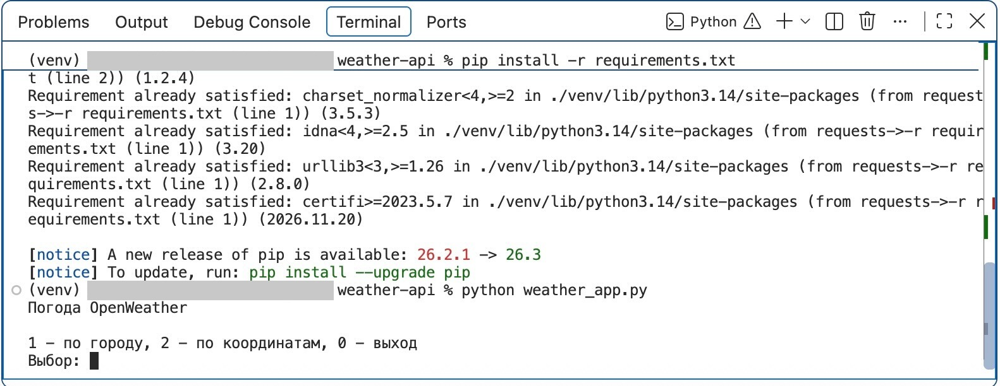
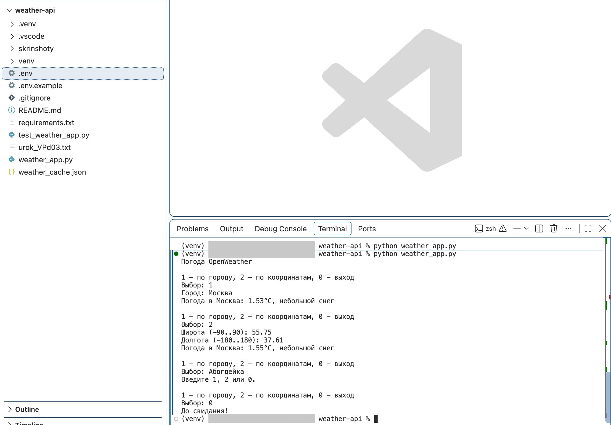
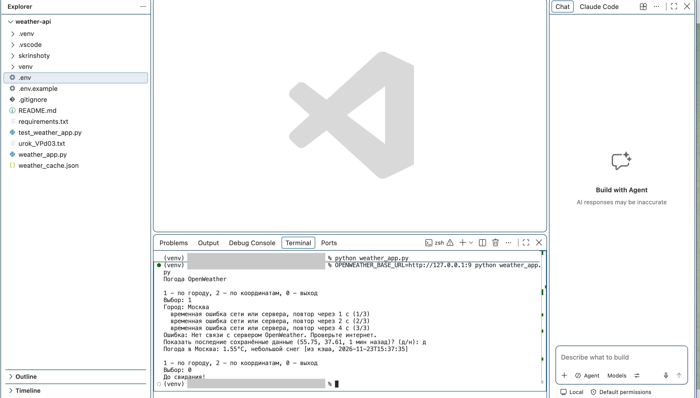
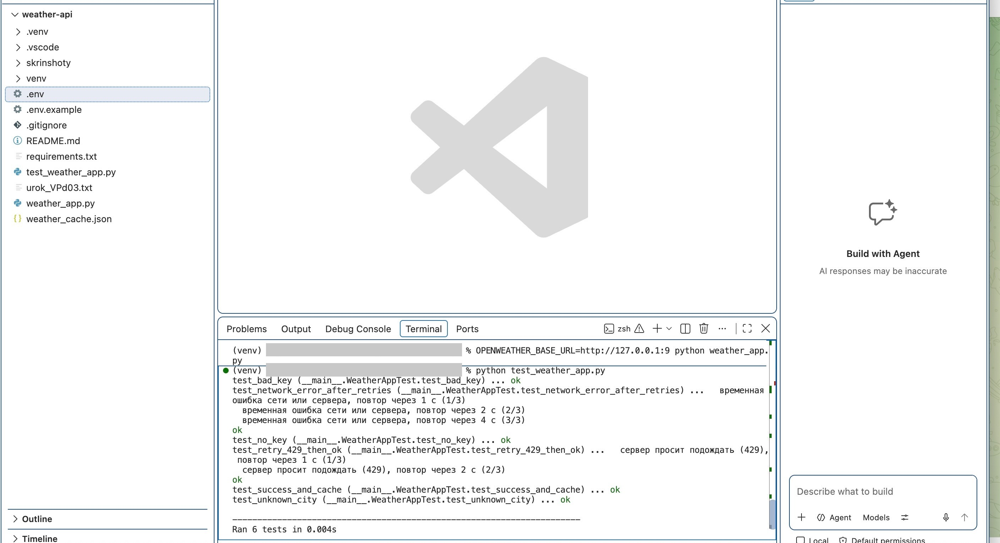
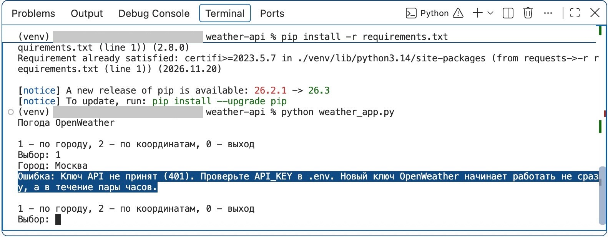
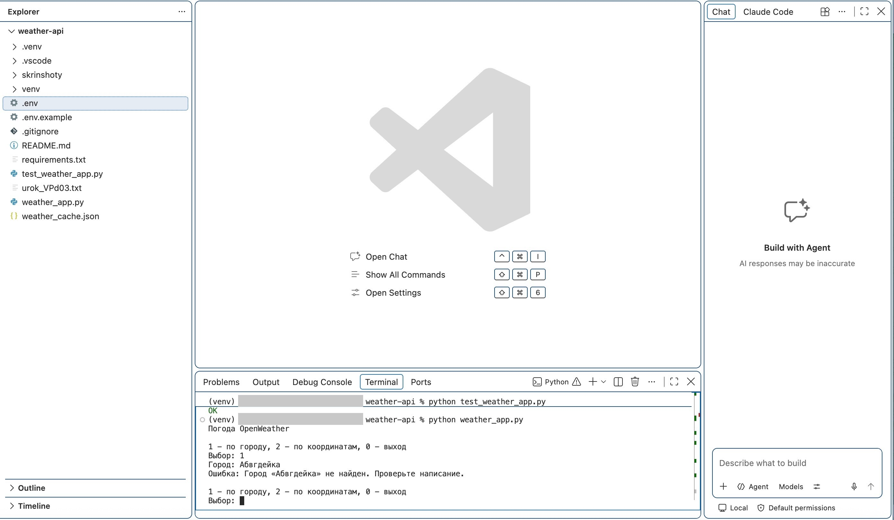

# Погода по городу через OpenWeather API

Учебное задание курса «Вайб-кодер 2.0», модуль 5 «Работа с API», урок «Авторизация и ключи». Выполнены базовый и средний уровни.

Консольная программа спрашивает город (или координаты) и печатает текущую погоду:

```
Погода в Москва: 12.4°C, пасмурно
```

Сначала город переводится в координаты через [Geocoding API](https://openweathermap.org/api/geocoding-api),
затем по координатам запрашивается [Current Weather](https://openweathermap.org/current).
Ключ API хранится в файле `.env`, в коде и в репозитории его нет.

## Что внутри

| Файл | Что делает |
|---|---|
| `weather_app.py` | приложение: `get_coordinates(city)`, `get_weather_by_coordinates(lat, lon)`, меню, кэш, повторы |
| `test_weather_app.py` | проверка без сети и без настоящего ключа (ответы сервера подменяются) |
| `.env.example` | образец файла с ключом |
| `requirements.txt` | `requests`, `python-dotenv` |

## Установка

Нужен Python 3.10 или новее.

```bash
python3 -m venv venv
source venv/bin/activate
pip install -r requirements.txt
cp .env.example .env
```

Откройте `.env` и впишите свой ключ с [openweathermap.org](https://home.openweathermap.org/api_keys):

```
API_KEY=ваш_ключ
```

Новый ключ OpenWeather начинает работать не сразу, обычно в течение пары часов. До этого сервер отвечает кодом 401, и программа так и пишет.

## Запуск

```bash
python weather_app.py
```

Меню: `1` по городу, `2` по координатам, `0` выход.

## Обработка ошибок

Все ошибки выводятся одной понятной строкой, без трейсбека:

| Ситуация | Что видит пользователь |
|---|---|
| нет файла `.env` или ключа | подсказка создать `.env` по образцу |
| неверный или ещё не активный ключ (401) | «Ключ API не принят (401)…» |
| город не найден (пустой ответ геокодинга) | «Город «…» не найден. Проверьте написание.» |
| координаты не числа или вне диапазона | «Значение должно быть от -90 до 90.» |
| другой код ответа | «OpenWeather вернул ошибку N.» |
| 429 или временный сбой сети / 5xx | до 3 повторов с паузой 1, 2, 4 с |
| сеть недоступна после повторов | сообщение и предложение показать данные из кэша |

Текст исключений `requests` на экран не выводится: в нём адрес запроса вместе с ключом.

## Кэш

Последний успешный ответ сохраняется в `weather_cache.json` вместе с `city`, `lat`, `lon`, `fetched_at`.
Если сети нет, программа предлагает показать эти данные, когда им меньше 3 часов. Файл кэша в `.gitignore`.

## Проверка

```bash
python test_weather_app.py
```

6 тестов: успешный запрос и запись кэша, неизвестный город, ключ 401, повторы при 429, сбой сети с тремя повторами, отсутствие ключа.

Сбой сети можно увидеть и вручную, направив запросы на закрытый порт:

```bash
OPENWEATHER_BASE_URL=http://127.0.0.1:9 python weather_app.py
```

## Отличия от урока

- В задании для геокодинга указан `lang=ru`. В документации Geocoding API такого параметра нет: русское название города приходит в поле `local_names.ru`. Параметр передаётся, как требует задание, сервер его не учитывает.
- Город в ответе печатается так, как его ввёл пользователь (как в примере задания «Погода в Москва»). Для режима координат берётся поле `name` из ответа погоды.

## Скриншоты

1. Запуск и меню



2. Погода по городу и по координатам



3. Нет сети: три повтора и данные из кэша



4. Тесты



5. Ключ ещё не активен или неверный (401)



6. Город не найден


